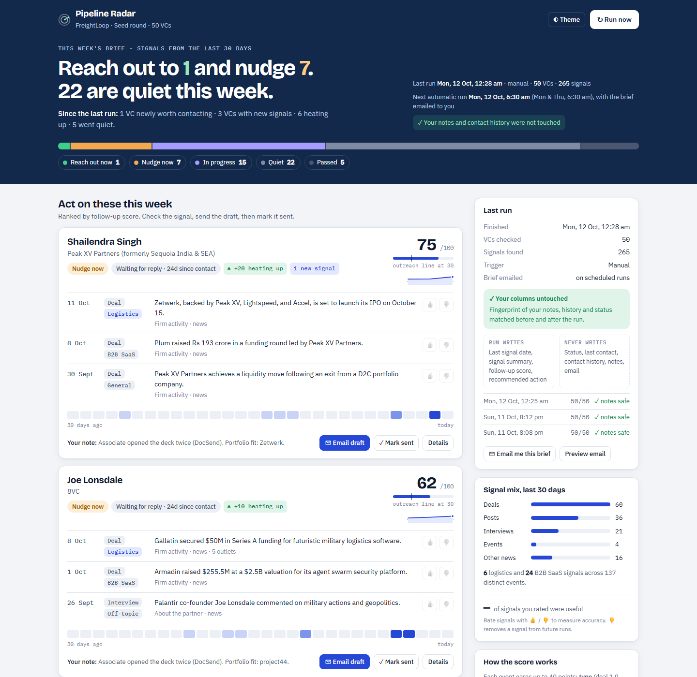
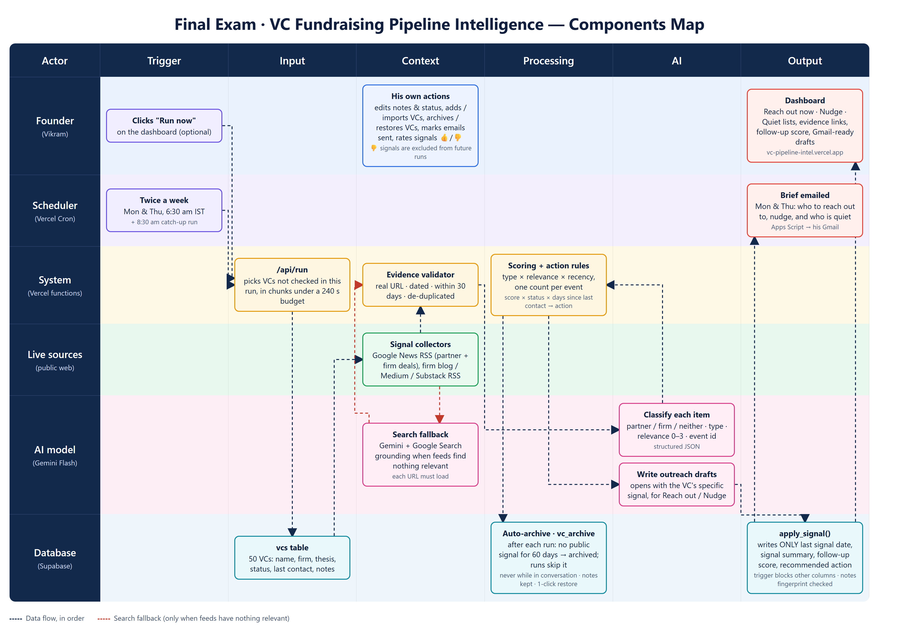

# Pipeline Radar · VC fundraising pipeline intelligence

**Live:** https://vc-pipeline-intel.vercel.app · MESA Cohort C4, AI and its Applications, Section 1 Final (High difficulty)



Vikram is raising a Seed round for a B2B logistics SaaS and tracks 50 VCs. Twice a week, before he works his pipeline,
Pipeline Radar checks what each VC did, wrote, said or invested in during the last 30 days, scores how receptive they are
right now, recommends an action, drafts the email, and emails him the brief. It updates **only** the four signal columns
of his Supabase table and never touches his notes or contact history.

## How each requirement is met

| Requirement | How |
|---|---|
| Live external data | Google News RSS (partner + firm deals), each firm's blog/Medium/Substack RSS, and Gemini with Google Search grounding as a fallback. |
| An observable signal from the past 30 days, with the reason | Every signal must have a real link and a date inside the window ([`src/core/validate.js`](src/core/validate.js)); the dashboard shows each one with its link. |
| Tell him about the quiet VCs too | VCs without a relevant signal are listed as "Quiet: skip this week", with the sources checked. |
| Twice a week, before he starts | Vercel Cron, Mon & Thu 6:30 am IST (+ 8:30 am catch-up). The brief is emailed to him from his own Gmail. |
| Supabase reflects the current state each run | Every run updates all VCs; a run that hits the time limit resumes where it stopped. |
| Never overwrite his notes; update only 4 columns | `apply_signal()` is the pipeline's only write path; a trigger rejects any pipeline write to his columns; every run fingerprints his columns before and after. |
| Gemini Flash for all AI | Item classification, relevance, summaries and email drafts. No other model. |

## Features

- **Weekly brief:** the plan in one sentence, all VCs by action, and what changed since the last run (newly actionable, heating up, went quiet).
- **Priority queue:** evidence per VC (type, relevance, link, "4 outlets" when several cover one deal), a 30-day signal strip and a score sparkline.
- **Email drafts:** open with the VC's specific signal; Open in Gmail, Copy, then **Mark as sent** (status → waiting, last contact → today, history line added, action → hold).
- **Feedback loop:** 👍/👎 on any signal. 👎 removes it from future runs for that VC; the ratings give a live accuracy figure.
- **Pipeline management:** add a VC (checked within seconds), import Vikram's spreadsheet as CSV, export CSV, edit his own columns.
- **Run proof:** which columns a run writes and never writes, and a "notes safe" check on every run.

## Architecture



```
api/                      Vercel functions (thin: auth → src → JSON)
  run.js                  cron + "Run now"; resumable under a 240 s budget
  vcs.js                  list / add / edit VCs (Vikram's columns only)
  actions.js              mark sent · feedback · CSV import · send / preview digest
  status.js               live run progress
src/
  core/                   pure, unit-tested logic: scoring, actions, validate, changes
  sources/                google-news, blog-rss, web-search (Gemini grounding), rss parser
  ai/                     gemini-client, classify, draft-email
  pipeline/run.js         collect → validate → classify → score → act → draft → apply_signal()
  notify/digest.js        the Mon/Thu brief email
  db/client.js · http.js · config.js
public/                   dashboard (index.html, app.js, styles.css)
supabase/migrations/      schema, guard trigger, apply_signal(), protected_hash()
apps-script/              DigestMailer.gs: sends the brief from Vikram's Gmail
test/unit/                scoring, actions, validation, change detection
docs/                     Components Map (docx, png), screenshots
```

### Scoring

Each event earns up to 40 points: type (deal 1.0, post 0.8, event 0.7, interview 0.6) × relevance (logistics 1.0, B2B SaaS 0.6,
general 0.15, off-topic 0.05) × recency (full for 7 days, fading to zero at 30). Several outlets covering one event count once;
off-topic activity adds at most 15. **Reach out** at 30+; a pending reply is never chased within 10 days of the last contact.

## Setup

```bash
npm install
cp .env.example .env          # fill in the keys
npm test                      # unit tests
npm run seed                  # writes supabase/seed.sql from data/vcs.json
npm run dry-run -- "Peak XV"  # live check of one VC, writes nothing
npm run pipeline              # full run from your machine
npx vercel deploy --prod
```

1. Create a Supabase project and run `supabase/migrations/*.sql` in order, then `supabase/seed.sql`.
2. Set the variables from `.env.example` in Vercel.
3. **Digest email:** open [script.google.com](https://script.google.com), paste `apps-script/DigestMailer.gs`, add a script property
   `DIGEST_SECRET` (same value as Vercel), deploy as a web app (Execute as: Me, Access: Anyone), and put the `/exec` URL in
   `DIGEST_WEBHOOK_URL`. "Email me this brief" on the dashboard sends a test.

## Assumptions and limits

- Thresholds (30 to reach out, 10 days before a nudge) live in [`src/core/actions.js`](src/core/actions.js).
- A deal by the firm counts as a signal for the partner on the list, labelled "Firm activity".
- Investor-database pages (Tracxn, Crunchbase, …) are filtered out: they list old rounds, not something the VC did.
- LinkedIn and X posts are not covered (no free API; scraping breaks their terms).
- The dashboard is open (no key) for the demo. Setting `DASHBOARD_KEY` in Vercel locks it again; a second "Run now" joins a run already in progress instead of duplicating it.
- VC emails are public firm-level addresses only. Vikram's status, history and notes in the seed data are fictional.

MIT licence.
